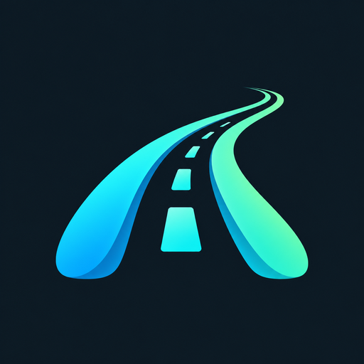
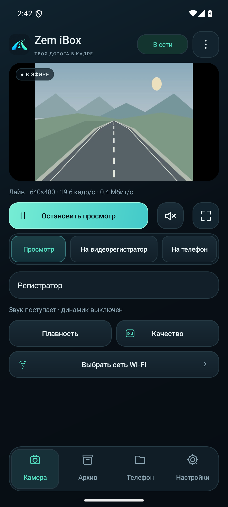
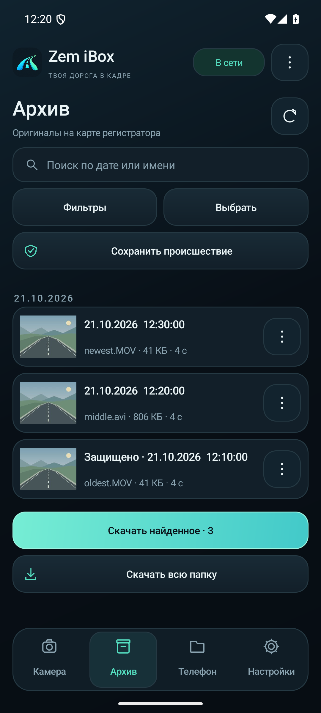
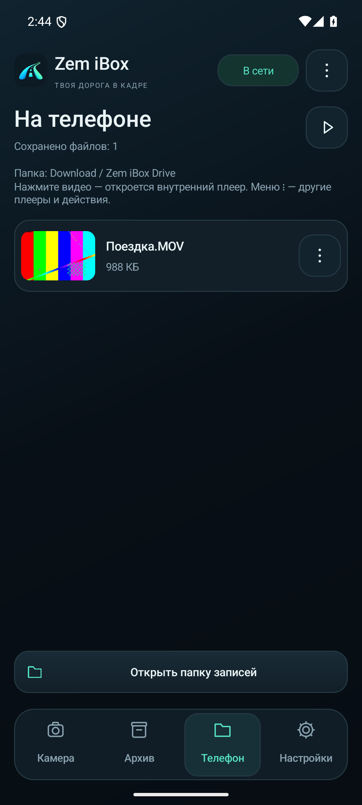
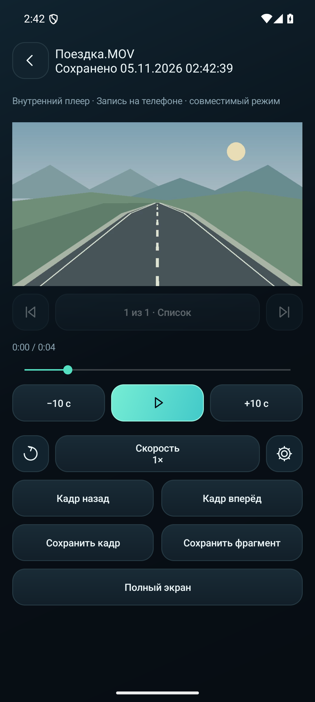
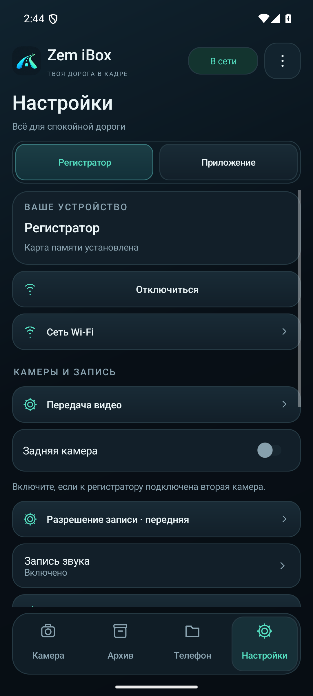

  

<h1 align="center">Zem iBox</h1>

Камера, архив и записи с видеорегистратора — на вашем телефоне.

  <a href="https://github.com/eltary/zem-ibox/releases/latest"><b>Скачать приложение</b></a> ·
  <a href="#установка">Установка</a> ·
  <a href="#подключение">Подключение</a> ·
  <a href="docs/COMPATIBILITY.md">Совместимость</a>

**Android 7.0 и новее · интерфейс на русском языке**

Zem iBox подключается к совместимому регистратору по Wi-Fi. В приложении можно
смотреть камеру, находить записи на microSD, скачивать оригиналы и сохранять
текущий просмотр в память телефона. Интернет для работы с регистратором не нужен.

Это неофициальный пользовательский проект для регистраторов, работающих с
**DVRunning2**. Идея появилась после ДТП: в нужный момент оригинальное приложение
не позволило ни посмотреть, ни скачать запись самого происшествия. Захотелось
сделать более удобное приложение, в котором можно быстро найти нужное видео,
посмотреть его и сохранить на телефон.

Приложение целиком написано с помощью **Codex**. Первую версию удалось собрать,
пока ждали ГАИ, — чтобы вытащить видео происшествия с регистратора.

P. S. Виновата была другая машина 🙂

## Совместимость

Приложение предназначено для регистраторов семейства **Jieli / DVRunning2**.

Проверен **iBOX Flash WiFi Dual**, прошивка 1.0.1.

Поддержка других устройств определяется их протоколом и возможностями прошивки;
совместимость со всеми моделями и функциями оригинального приложения не обещается.

Поддерживаются собственные потоки Jieli TCP/UDP и RTSP, H.264 и MJPEG.
Заднюю камеру нужно включить в настройках, если она действительно подключена.
Подробности и ограничения собраны в [таблице совместимости](docs/COMPATIBILITY.md).

## Что умеет приложение

- **Камера:** просмотр со звуком, полный экран, выбор качества, передняя и задняя камеры.
- **На видеорегистратор:** управление записью на microSD, фото и защита текущего ролика.
- **На телефон:** сохранение кадра или видео текущего просмотра с таймером записи.
- **Архив:** миниатюры, фильтр, поиск, просмотр и скачивание оригиналов с продолжением после обрыва.
- **Внутренний плеер:** очередь видео, перемотка, скорость и поворот экрана.
- **Настройки:** доступные параметры регистратора, проверка времени и форматирование microSD с подтверждением.
- **Диагностика:** короткий отчёт и журнал для разбора проблем; запись логов включается вручную.

## Скриншоты

Экраны приложения с демонстрационным видео.

| Камера | Архив |
| :---: | :---: |
|  |  |

| Записи на телефоне | Внутренний плеер |
| :---: | :---: |
|  |  |

Настройки регистратора

## Установка

1. Откройте [последний релиз](https://github.com/eltary/zem-ibox/releases/latest).
2. Выберите APK из таблицы ниже и скачайте его.
3. Разрешите установку из выбранного браузера или файлового менеджера, если Android попросит.
4. Установите приложение. Для обновления установите новую версию **поверх предыдущей**.

| Вариант APK | Для каких устройств |
| --- | --- |
| `arm64-v8a` | Большинство современных Android-телефонов. |
| `armeabi-v7a` | Устройства с 32-битным ARM. |
| `x86` | 32-битные устройства и эмуляторы Intel/AMD. |
| `x86_64` | 64-битные устройства и эмуляторы Intel/AMD. |
| `universal` | Все четыре архитектуры в одном APK. Выбирайте, если не знаете архитектуру устройства. Файл больше. |

Все варианты имеют одинаковые функции.
Приложение устанавливается вручную; автоматического обновления нет.

APK приложения подписаны отладочным сертификатом **Android Debug**.
[Данные сертификата и его SHA-256](docs/signing-certificate.json) опубликованы в репозитории.

## Подключение

1. Включите регистратор и его Wi-Fi.
2. Подключите телефон к **сети регистратора** в настройках Android.
3. Если телефон сообщает «Без доступа к интернету», оставьте это Wi-Fi-подключение.
4. Закройте приложение производителя, если оно уже использует камеру.
5. Откройте Zem iBox и нажмите **«Подключить»**, затем **«Начать просмотр»**.

Для **iBOX Flash WiFi Dual** стандартный пароль Wi-Fi — **`12345678`**
([инструкция производителя](https://iboxstore.ru/upload/iblock/cd5/2wal9laee99sg09jqwvqitler4fmp0ve/Full%20Manual_Flash%20WiFi%20Dual_25.03.2021.pdf)).
У других моделей пароль может отличаться; если вы меняли его, используйте свой.

Если автоматическое определение не сработало, задайте адрес в
**Настройки → Регистратор → Адрес подключения**. Обычно регистратор доступен по
`192.168.1.1`, но фактический адрес зависит от устройства.

После подключения приложение проверяет время регистратора. Если оно отличается
от времени телефона больше чем на пять минут, приложение предлагает синхронизацию.
Изменение времени выполняется после вашего подтверждения.

## Где сохраняются записи

**«На видеорегистратор»** управляет записью на microSD внутри регистратора.
Оригиналы этих файлов находятся во вкладке **«Архив»**.

**«На телефон»** записывает текущий видеопоток в память телефона. Эта функция
может работать и без microSD. Файлы сохраняются в `Download/Zem iBox Drive`,
а список доступен во вкладке **«Телефон»**. Кнопка **«Открыть папку записей»**
передаёт папку установленному файловому менеджеру.

Запись лайва сохраняет полученный поток. Если нужен исходный ролик с карты
регистратора, скачайте его из архива. Разрешение лайва и оригинала могут отличаться.
Если устройство не передаёт аудио, приложение сообщает о сохранении без звука.

Нажатие на локальное видео запускает **внутренний плеер**. В меню **⋮** находятся
**«Открыть в…»**, **«Открыть через VLC»** и отправка файла. Внутренний плеер
работает без установки отдельного приложения VLC; для внешнего запуска VLC
должен быть установлен на телефоне.

## Качество и плавность

Фактическое разрешение видно в состоянии лайва. Некоторые прошивки отдают Full HD
даже при запросе меньшего качества, особенно во время записи на microSD.
В выборе качества есть действие **«Повторить без записи на регистраторе»**:
оно отдельно просит подтвердить остановку записи. Параметры оригинальных роликов
на microSD автоматически не меняются.

Если изображение не появляется, проверьте другой транспорт:
**Настройки → Регистратор → Передача видео**. Режим «Автоматически» выбирает
транспорт из описания устройства. RTSP пробует UDP, если TCP не дал изображения.

Для просмотра тяжёлых роликов и высокой скорости стабильнее сначала скачать
оригинал на телефон: при 4× поток по Wi-Fi требует примерно в четыре раза больше
пропускной способности. Производительность также зависит от декодера и телефона.

## Форматирование microSD

Откройте **Настройки → Регистратор → Карта памяти → Форматировать microSD**.

**Форматирование удаляет все файлы на карте, включая защищённые.**
Приложение запросит подтверждение и остановит запись на регистраторе.
Сохранённые на телефоне файлы остаются. Не отключайте питание до завершения.
После форматирования запись на регистраторе нужно включить вручную.

Если устройство перезагружается раньше, чем удаётся подключиться,
отправить команду из приложения не получится — потребуется кардридер.

## Если что-то не работает

| Проблема | Что проверить |
| --- | --- |
| Регистратор не находится | Телефон подключён к его Wi-Fi; приложение производителя закрыто; указан правильный адрес. |
| Есть подключение, но нет картинки | Другое качество или транспорт. Устройство может поддерживать не все предлагаемые режимы. |
| Нет звука в лайве | Кнопка динамика рядом с запуском просмотра; микрофон регистратора; наличие аудио в самом потоке. |
| Архив пуст | Наличие microSD, выбранную камеру и фильтры. При ошибке используйте обновление списка. |
| После удаления файла он остался в списке | Вернитесь во вкладку «Телефон»: приложение повторно проверит доступность файлов. |
| Тормозит просмотр по Wi-Fi | Скачайте оригинал и откройте локальный файл. Проверьте аппаратный и совместимый режимы плеера. |
| Нужна диагностика | Откройте настройки приложения и «Логи и диагностика». Включите запись логов, повторите проблему и приложите короткий отчёт с описанием действий. Полный журнал можно отправить отдельным файлом. |

## Конфиденциальность и лицензии

Для работы не нужны аккаунт, облако или разрешение на микрофон телефона.
Приложение использует локальную сеть регистратора и файлы, доступ к которым вы открыли.
Запись логов по умолчанию выключена. Пароли скрываются в диагностическом отчёте. Перед отправкой полного журнала
проверьте его содержимое: он может включать сведения о вашей локальной сети и файлах.

Собственный код Zem iBox распространяется по [лицензии MIT](LICENSE).
Сторонние библиотеки сохраняют свои лицензии.

Воспроизведение использует **libVLC 3.7.7**. Лицензии, оригинальные уведомления и
русский перевод доступны в **Настройки → Приложение → О приложении и лицензии**.
Исходные уведомления: [лицензия libVLC](app/src/main/assets/libvlc-LICENSE.txt) и
[зависимости](app/src/main/assets/third-party-notices.txt).

Для разработчиков: [сборка и тестирование](docs/DEVELOPMENT.md),
[совместимость](docs/COMPATIBILITY.md), [история изменений](CHANGELOG.md).
